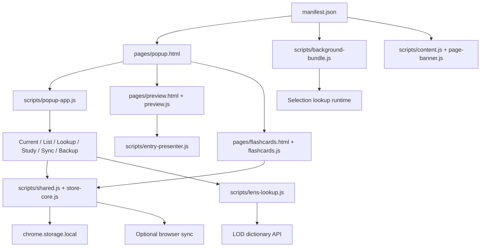

# LODVault architecture

## Purpose

LODVault is a local-first browser extension for saving and reviewing Luxembourgish vocabulary from LOD. It includes a popup, a searchable Vault page, Flashcards, an article banner and selection-based LOD Lens lookup.

## Scope and assumptions

Verified on 2026-10-17 against `manifest.json`, `package.json`, the page entry points and their script lists. This is a plain HTML/CSS/JavaScript extension, not a web application with a server. There is no `src/` tree or Python runtime.

This change consolidates Popup, Vault and Flashcards layout. The article banner and LOD Lens are not redesigned.

## System overview

The manifest loads the popup and background service worker. Each extension page loads storage/presentation helpers before its page controller. Content scripts attach the article banner to lod.lu. Background code coordinates extension messaging and optional Lens injection.

Local storage remains authoritative. Browser sync is a compact replica, and JSON backups are portable copies.

## Architecture diagram

## Runtime entry points

- `manifest.json`: `pages/popup.html`, `scripts/background-bundle.js`, article content scripts and the `open-lod-lens` command.
- `pages/preview.html`: `scripts/preview.js`, the live Vault and its generated iframe document.
- `pages/flashcards.html`: `scripts/flashcards.js`, review sessions.
- `scripts/popup.js`: initializes the popup app and handles section navigation.
- `package.json`: Node tests, background build and release/package lint commands. `scripts/build_release_zip.sh` emits Chrome and Firefox variants.

## Architectural layers

1. Page HTML and CSS own layout, scroll containers and theme tokens.
2. Page controllers own UI events and rendering. Popup responsibilities remain split across `scripts/popup-*.js`.
3. `scripts/shared.js`, `scripts/store-core.js`, `scripts/note-autosave.js` and `scripts/entry-presenter.js` provide storage contracts, autosave and presentation helpers.
4. `scripts/lens-lookup.js` provides dictionary lookup and canonical entry retrieval.
5. Background and sync modules coordinate mutations, extension messaging and replication.

Dependencies point from page controllers toward these helpers. Layout changes must not change persistence semantics.

## External integrations

- LOD dictionary search and article content, plus pronunciation audio from lod.lu.
- Browser local/sync storage and extension tab, scripting and context-menu APIs.
- Browser history only through its optional permission.
- Chrome/Firefox packaging via the existing release script and web-ext lint.

## Core data flow, current

1. My vault filters saved entries locally. It sends no dictionary request.
2. Search LOD delegates to the lookup module. New dictionary saves fetch a canonical entry before mutation. Stale responses cannot replace a newer query.
3. Mutations update local entries. Storage refreshes update membership and presentation without replacing live lookup editors.
4. The Vault renders generated export HTML inside an iframe, then adds live edit controls. Preview refreshes preserve its edit and scroll state.
5. Flashcards reads entries and review metadata and persists review progress through the existing store.

## Module ownership boundaries

- `styles/blue-night.css`: shared tokens, buttons, menus and companion-page header behavior. Generated export tokens in `scripts/entry-presenter.js` must match theme changes.
- `styles/popup.css` and `pages/popup.html`: bounded popup shell, fixed search controls, current-word disclosure inside the Words scroller and a collapsing status/Undo footer below it.
- `scripts/popup-lookup.js`: remote query/language state, stale-request protection, hydration, membership patching and note-recovery behavior. It retains result DOM across an unchanged source round trip.
- `scripts/popup-list.js`: local filtering and saved rows. Retained rows reuse live note sections during refresh.
- `scripts/popup-current.js`: active article and current-note behavior.
- `scripts/popup-app.js`: module wiring, storage/tab events, autosave, feedback and delete/Undo.
- `scripts/preview.js` and `styles/preview.css`: live Vault editing and remaining-height iframe layout.
- `scripts/flashcards.js` and `styles/flashcards.css`: review behavior and responsive card/session controls.

## Architecture change protocol

Keep storage schemas, permissions, dictionary privacy and review scheduling unchanged during UI work. Preserve note flush/recovery and canonical-entry hydration tests. Avoid moving remote lookup lifecycle code into the export presenter merely to share markup.

Run `npm test`, `npm run test:ui`, `npm run test:popup` and `npm run lint` for changes to these UI contracts. The browser check uses an isolated profile and fixtures, not real vault data.

## Future clarifications

The actual Chrome action window is checked through a debugging pipe in an isolated profile, separately from page emulation. Its host can clamp height and add gutter space. Firefox rendering, screen-reader output and increased zoom still require manual verification. Page geometry checks alone cannot validate native popup auto-sizing.
