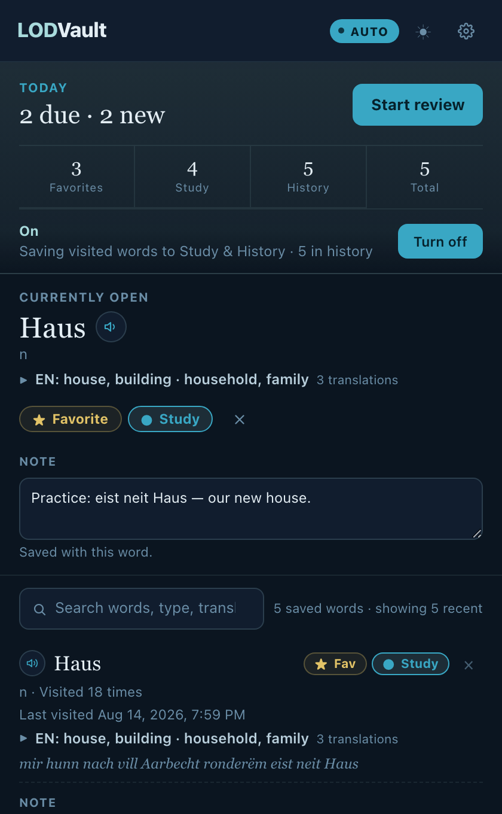
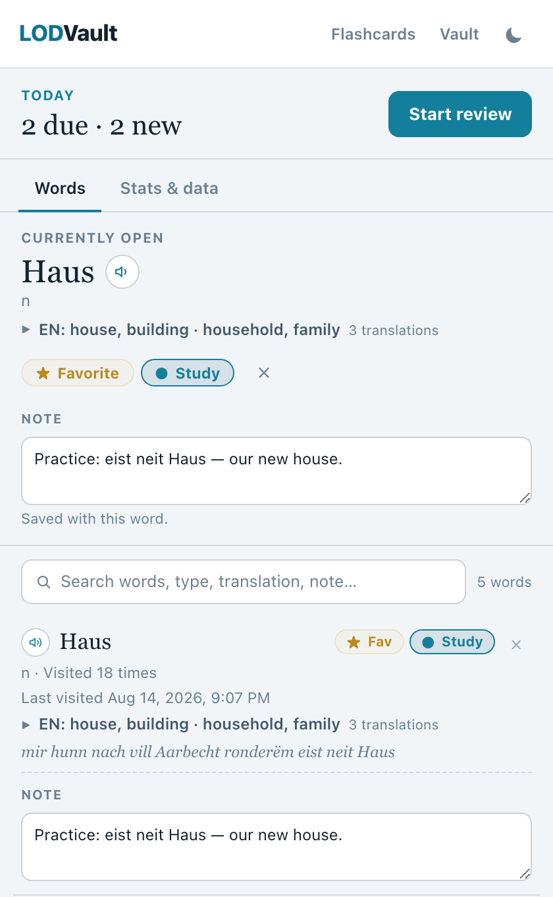
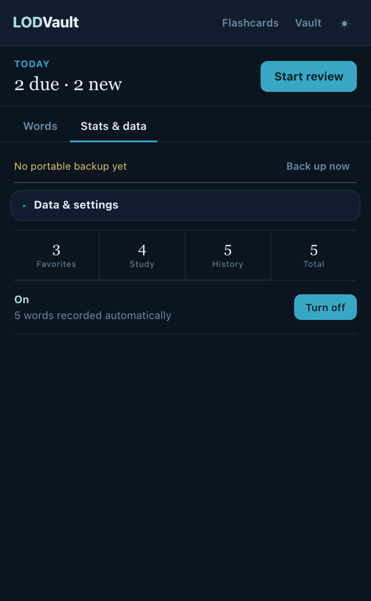
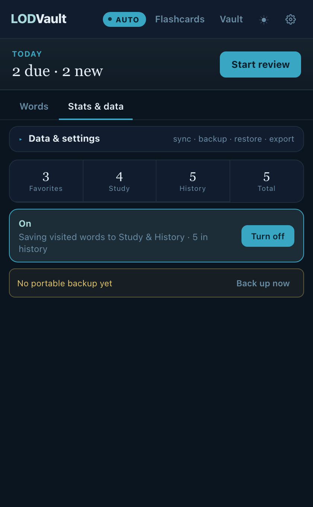
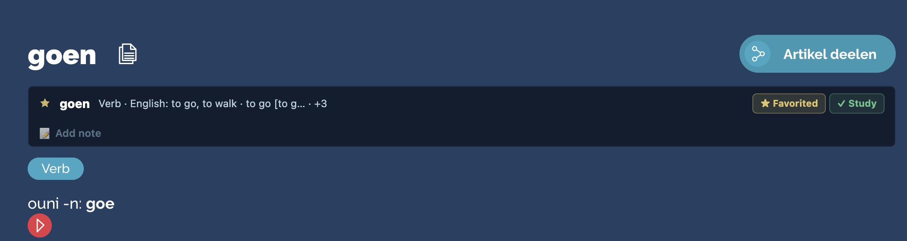
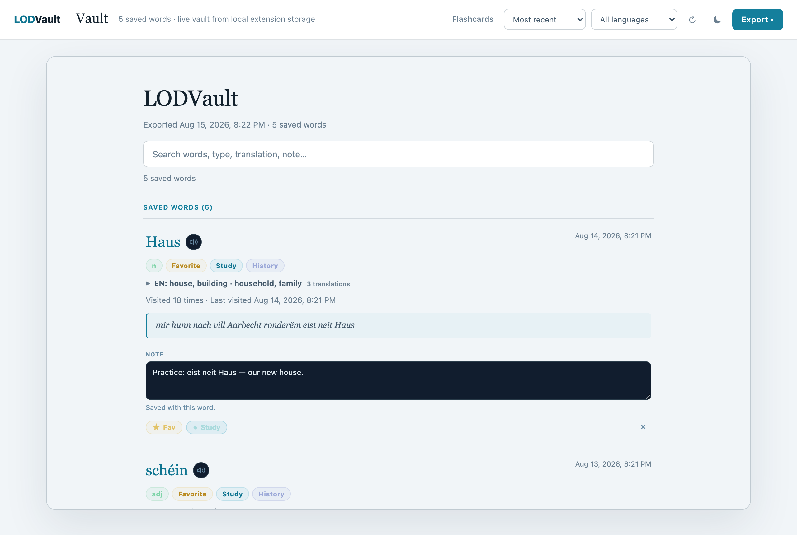
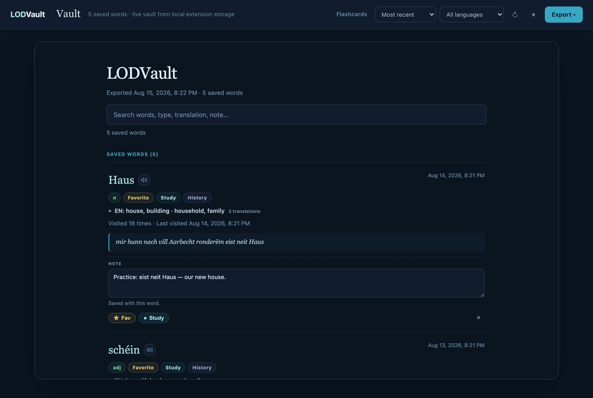
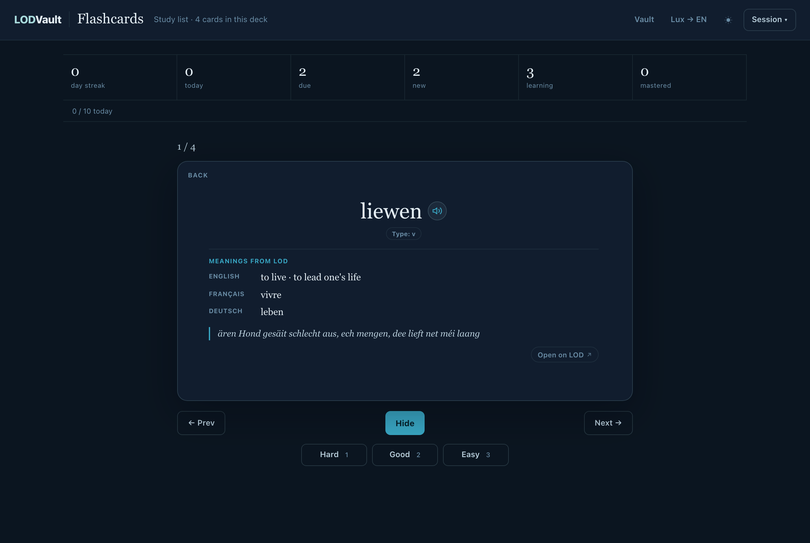
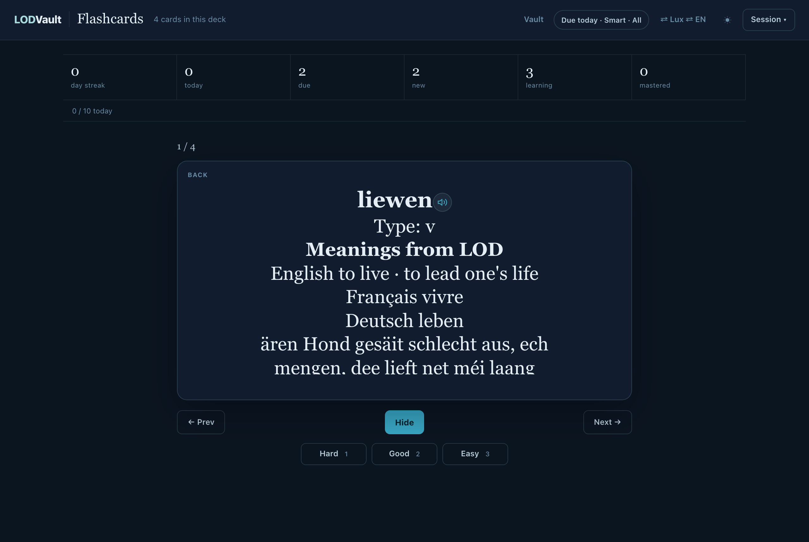

<div align="center">
  
  <h1>LODVault</h1>
  <p><strong>Your personal vocabulary vault for lod.lu</strong></p>
  <p>
    Save Luxembourgish words as you browse, study with flashcards,<br/>
    add notes, and export your list from the dictionary.
  </p>
  <p>
    <a href="https://lod.lu">lod.lu</a> ·
    <a href="https://chromewebstore.google.com/detail/gdileleimdnibmieodhnjijmepjdfgil?utm_source=item-share-cb">Chrome Web Store</a> ·
    <a href="#install">Install</a> ·
    <a href="#features">Features</a> ·
    <a href="#credits">Credits</a> ·
    <a href="LICENSE">MIT License</a>
  </p>
</div>

---

### Popup

 

The popup opens on a **Today** panel with today's due and new words, your streak and Start review, then splits into **Words** and **Stats & data**. Words keeps My vault / Search LOD, search and its metadata fixed above one scrolling area. Current-page details expand inside that area without moving search. Stats & data groups sync, backup, restore, exports, counters and Auto mode. Header links take you straight to Flashcards or the Vault, and the ☀/☾ button flips the whole product between navy night and cool paper day.

 

---

### Article banner



A banner appears under the heading on each `lod.lu/artikel/…` page. Save the word to Favorites or Study, read its translations or add a note.

---

### Vault

Add tags with **+ Tag** on each word. The **Decks** button saves filters for tag, part of speech, gender, level, Favorites/Study, leech status and due date. Flashcards lists saved filters under **My decks**. Level filters require downloaded lexicon details; they do not download category word lists. Tags and saved decks sync together within a 7,000-byte payload budget; overflow stays local. A persistent Vault warning counts omitted tags, decks and deferred deletions. Deferred deletions may still appear on other devices. JSON backups retain all records. Editing requires a browser with Web Locks; unsupported browsers refuse writes rather than risk losing another page's changes.

 

The Vault lists your saved words with translations, examples and notes. Search, filter by language or change the sort order. Use **Export ▾** to download HTML or Anki files.

---

### Flashcards

 

Choose **Session → Mode → Write the word** to type the Luxembourgish word from a cached LOD meaning. Check the answer, then continue with the suggested grade or use an explicit override. Accent slips receive Hard. Nouns ask for the article. Writing uses the core word's schedule, retries and undo, not a separate skill schedule. The same Mode menu offers **Write the plural**, **Hunn/sinn + participle**, **Fill the gap** and **Choose the gender**, using cached LOD forms and examples. All question modes share the word's schedule. If the selected exercise lacks dictionary data, it explicitly falls back to writing the word. Progress sync reserves space for core schedules before optional skill schedules. Missing dictionary details show a message and request a bounded download; switch modes and try again after it completes.

Open **Session ▾** to choose a deck, study mode and daily limits. Reveal an answer, then choose Again, Good or Easy. Each button shows when the word will return. You can enable Hard in the session settings, undo your last grade and resume a session after closing the tab.

---

## What is LODVault?

[LOD — Lëtzebuerger Online Dictionnaire](https://lod.lu) is the official Luxembourgish dictionary. It is well-designed and comprehensive, but it has no way to save words, track vocabulary, or study what you have looked up.

**LODVault** is a browser extension that adds that layer on top of LOD. It saves words locally as you browse LOD. No account is required. You can also enable browser sync.

---

## Features

| | |
|---|---|
| 📌 **Save words** | Favorite or add to Study directly from any LOD article page |
| 🤖 **Auto mode** | Automatically record every visited LOD article into Study and History |
| 🔊 **Pronunciation audio** | Play LOD pronunciation audio from the popup and saved-word list |
| 📝 **Notes** | Write your own note for each saved word (auto-saved) |
| 🔎 **LOD Lens** | Select Luxembourgish text on supported pages to translate it in a floating overlay, then save it straight to your vault |
| 🔍 **Search** | Switch between My vault and Search LOD in the popup. Look up Luxembourgish, English, French, German, Portuguese, or Dutch words and save the Luxembourgish entry to Favorites or Study |
| 🃏 **Flashcards** | Review a daily queue of due words plus new Study words up to your new-word limit. Missed words come back once in the same session |
| 🔔 **Due badge** | See how many words are due on the toolbar icon (reviews only, not new words), updated at local midnight |
| 👁 **Preview** | Browse your full word list in a clean page — no download needed |
| 📤 **Export HTML / Anki** | Download standalone HTML or Anki-ready text export |
| 📦 **Backup / Restore JSON** | Back up and restore your vocabulary, flashcard review progress, and supported settings with a portable file |
| 🕘 **Optional browser history import** | On demand, import missing `lod.lu/artikel/*` words from history (add-only), with selectable date range and import report |
| ☁️ **Optional browser sync** | Sync a compact copy of your words and review progress across Chrome profiles with configurable language selection, capacity indicator, and manual **Sync now** (helpful, but not an uninstall-safe backup) |
| 🔒 **Local-first** | `chrome.storage.local` stays authoritative; sync is only a compact replica |

<h2 id="install">Install</h2>

LODVault is available on the Chrome Web Store:

- **Chrome Web Store:** https://chromewebstore.google.com/detail/gdileleimdnibmieodhnjijmepjdfgil?utm_source=item-share-cb

If you prefer, you can still load it directly from source.

### Requirements
- Google Chrome, Microsoft Edge, or any Chromium-based browser

### Install from the Chrome Web Store

1. Open the store listing:
   https://chromewebstore.google.com/detail/gdileleimdnibmieodhnjijmepjdfgil?utm_source=item-share-cb
2. Click **Add to Chrome**
3. Confirm the installation

### Install from source

1. [Download or clone this repository](https://github.com/Mohammed-Ashour/lod-vault)

   ```bash
   git clone https://github.com/Mohammed-Ashour/lod-vault.git
   ```

2. Open your browser and go to:

   ```
   chrome://extensions
   ```

3. Enable **Developer mode** (toggle in the top-right corner)

4. Click **Load unpacked**

5. Select the `lod-vault` folder

The **LODVault** icon will appear in your browser toolbar.

> If you change background source files locally, rebuild the service worker bundle before reloading the extension:
>
> ```bash
> npm install
> npm run build:background
> ```
>
> `scripts/background-bundle.js` is a generated packaging artifact. Treat `scripts/background-impl.js` and `scripts/build-background.mjs` as the source of truth.

> **Important:** Before uninstalling LODVault or switching between unpacked and published builds, use **Backup JSON**. In Chrome, uninstalling the extension may remove both its local data and its extension sync data, even when the extension ID stays the same.

---

## How to use

### Save a word
1. Open any word page on LOD, for example:  
   `https://lod.lu/artikel/SOZIALIST1`
2. A **LODVault banner** appears directly under the word title
3. Click **Save to Favorites** or **Add to Study**

### Manage your words
- Click the **LODVault icon** in your browser toolbar to open the popup
- Turn **Auto mode** on if you want every visited LOD article to be added to **Study** and **History** automatically
- Choose up to **3 sync languages** for sync payload size control and use **Sync now** when you want an immediate push
- Use **Import history** with a date range (7d / 30d / 90d / 365d / all time) to add missing LOD words
- Review the import report and use **Backup JSON** before uninstalling or changing installations if you want a portable backup
- **My vault** filters saved words without sending a dictionary request
- **Search LOD** searches all supported languages by default, or a selected language. Favorite and Study are available on each result and fetch the full entry before saving. Expand a result for translations, an example and notes
- Dictionary searches send only the query text to LOD. Switching back to My vault keeps your local search
- Play pronunciation audio, add notes, toggle lists, or delete saved words from there

### Study with flashcards
- Click **Start review** or **Flashcards** in the popup to open **Today**: learning cards first, then due reviews ordered by recall strength with new Study words interleaved up to your new-word limit (none, 5, 10, 15 or 20 a day, or no limit; default 10). An optional review limit (50, 100 or 200 a day) caps how many due words Today offers. Due reviews never use up new-word slots; when the backlog is more than twice a usual day, Today halves the new words until it is under control
- Today's numbers count words, not button presses: a word you missed and retried is one word
- A word with no saved translation is asked forward in reverse and multiple-choice modes, so the answer never shows on the front
- Change the new-word limit or pick another deck (Due today, Study list, Favorites, All saved) under **Session**
- Click the card or **Reveal** to show the full meaning, then grade yourself: **Again** (1), **Good** (2) or **Easy** (3). Each button shows when the word will come back, e.g. `Again <10m · Good 9d · Easy 23d`. Turn on **Session → Show a Hard button** for Again / Hard / Good / Easy on 1–4
- Scheduling uses FSRS-5 (the open spaced-repetition model also used by Anki) with its default parameters. It tracks how stable each word is in your memory and brings it back when you are about to forget it. **Recall goal** (85%, 90% or 95%) trades fewer reviews against remembering more; **Longest gap** caps intervals at 1 or 10 years
- Learning words return after about three other cards, with later retries spaced further apart. Good advances the learning step; Easy graduates immediately. A forgotten review card gets a relearning step
- Today resumes automatically when reopened on the same day, including retries. All decks end with a summary instead of looping over rated words
- Press U or Ctrl+Z to undo a review. End session or Escape opens an early summary with distinct cards, first-try accuracy, active time, missed words and tomorrow's forecast
- Practising a word that isn't due (Study list, Favorites, All saved) is logged but doesn't move its schedule. Missing it brings it back tomorrow at the latest
- Words reviewed with an older version switch to the new scheduler the next time you review them; their due dates don't change until then
- Choose **Session → Mode → Listening** to hear the pronunciation without seeing the answer. Click **Reveal** (or press Space) to see the Luxembourgish word and translations, then rate it as usual
- **Streak:** a day counts when you clear the Today queue or do at least 10 reviews. Each 7 counted days earn a streak freeze (up to 2), which covers a missed day automatically. Days before you updated to this version count whenever you reviewed anything. Daily totals sync, so the streak is the same on every device
- Listening plays automatically when a card appears. Click the speaker or press **P** to replay. If browser autoplay is blocked or LOD audio is unavailable, try the speaker again, reveal the answer, or skip the card. Listening uses LOD audio and needs a network connection; reverse direction is disabled in this mode

### Track your progress
- Click **Progress** in the popup or the Flashcards header to open the stats page
- A year of study as a heatmap (❄ marks a day a streak freeze covered), your streak, best streak and freezes
- Reviews due over the next 30 days, a long-gap recall proxy (21+ days since the previous review) alongside your target, not retention measured by pre-review stability, and **words you know**: words you'd recall with at least 90% probability now. Until a word has the new scheduler's memory data, this is estimated from its review interval, and the page says so
- Average time per card once reviews record it, and your words by part of speech and, once LOD word details are downloaded, by *Schwätzt Dir Lëtzebuergesch?* level
- Pick optional **rest days** that neither count towards nor break your streak. They apply from the day you choose them
- Turn on a daily **reminder** at a time you choose ("12 due · 3 new · about 3 min"). It asks for notification permission when you turn it on, stays quiet when nothing is due or you've already studied that day, and opens Today when you click it. Reminders are set per device
- Optionally let the toolbar badge count today's new words as well as due ones

### Use LOD Lens on other sites
- Select a Luxembourgish word or short phrase on a supported page
- Click the floating **LODVault** trigger, use the page context menu, or press **Alt+Shift+L**
- Review the LOD translation in the floating overlay and save it to **Favorites** or **Study**
- Privacy note: LOD Lens runs in the browser and does not upload full page contents. Only the text you choose to look up is sent to the LOD dictionary API so the extension can fetch the translation.

### Preview and export
- **Preview** — opens a live, searchable page of your saved words in a new tab
- **HTML** — downloads a standalone HTML file you can keep or share
- **Anki** — downloads a tab-separated text file ready for Anki import
- **Backup JSON** — downloads a full portable backup of your saved words, flashcard review progress, and extension settings; use this before uninstalling or switching versions. Tick **Include dictionary details** to add the locally cached LOD details (genders, plurals, senses, examples) as well; they are otherwise fetched again from LOD after a restore
- **Restore JSON** — restores or merges a previous backup, including supported settings and flashcard review progress
- **Import history** — optionally requests browser History permission and adds missing `lod.lu/artikel/*` words into your vault (does not delete or overwrite existing words)

---

## Testing

LODVault includes a small automated test suite to keep the core behavior stable.

### Run the tests

```bash
npm install
npm test
```

### Check UI layout in Chrome

```bash
npm run test:ui
# Check the actual extension action window in recent Chrome:
npm run test:popup
# Also regenerate the before/after screenshots:
npm run test:ui -- --capture
```

Uses isolated browser/storage fixtures, not your real vault or live LOD requests. Set `CHROME_PATH` if Chrome is not in its default macOS location or Chromium is not on PATH.

### Lint the Firefox package

```bash
npm run lint
```

Builds the release zips and runs `web-ext lint` on the Firefox artifact (`dist/lodvault-firefox.zip`). Expected result: zero errors and zero warnings. Chrome cannot load a manifest that contains `background.scripts` (MV2-only in Chrome), so the Chrome zip (`dist/lodvault.zip`) keeps the plain `service_worker` manifest, and the release build emits a Firefox-only manifest with `background.scripts` for the Firefox zip — both from the same `manifest.json` source.

### What is covered
- shared storage and migration logic
- save / remove / note flows
- JSON import / export behavior
- export HTML generation
- popup rendering, sync language selection, default recent list behavior, and search filtering
- flashcard deck refresh behavior when extension storage changes
- background mutation queue behavior, sync bridging, LOD tab reloads on install, and Lens runtime injection
- content-script extraction from LOD article pages
- injected banner rendering, messaging, and saved-entry enrichment
- Lens trigger heuristics plus stale-session protection for async sentence actions
- compact sync serialization, merge behavior, sharding, and quota fallback logic
- review scheduling, the Today queue, the due badge, and review-progress sync
- daily activity totals, streak rules and freezes, and their sync and backup

---

## Privacy

- LODVault does **not** collect, transmit, or share data with any external service
- Everything you save lives in your browser via `chrome.storage.local`
- If browser sync is enabled, a compact replica is stored in `chrome.storage.sync`
- In Chrome, uninstalling the extension may remove both local data and its extension sync data, so use **Backup JSON** if you want a portable backup before uninstalling
- No analytics or tracking. Dictionary search and LOD Lens send only the text you choose to look up to the LOD API; they do not send page contents or personal notes

---

<h2 id="credits">Credits</h2>

LODVault is built on top of [LOD — Lëtzebuerger Online Dictionnaire](https://lod.lu),  
the official Luxembourgish dictionary maintained by the  
[Zenter fir d'Lëtzebuerger Sprooch](https://portal.education.lu/zls/)  
under the Luxembourg Ministry of Culture.

All dictionary content, word definitions, and translations belong to LOD and their respective rights holders.  
LODVault stores the words and dictionary details you save for personal study. Dictionary content belongs to LOD and its respective rights holders.

---

## License

[MIT](LICENSE) © 2025 Mohammed Ashour
