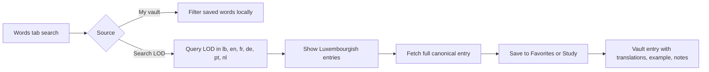

# Direct LOD search from the popup

## Before and after

| Before | After |
|---|---|
|  |  |

Before, the popup search only filtered words already saved in the vault. Users had to go to lod.lu first, open an article, then save from there.

After, the same search area has an explicit source switch:

## What changed

- Added **My vault / Search LOD** in the Words tab.
- Search LOD supports all LOD languages this extension already stores: Lëtzebuergesch, English, French, German, Portuguese, and Dutch.
- Saving a search result fetches the full canonical LOD entry first. Search previews are never saved as partial entries.
- Dictionary lookup does not count as a visit and does not add History.
- Existing notes and list memberships survive refreshes and repeated saves.
- Notes in expanded dictionary results autosave, including slow-save, deletion, and restore cases.
- Updated privacy copy to say exactly when the extension contacts LOD.

## Review notes

A read-only reviewer pass found issues around note-draft races, deleted entries, focus handling, cached language matches, membership feedback, and privacy wording. Those were fixed and covered with regression tests. See `docs/direct-lod-search-review.md`.

## Validation

- `npm test`: 246 passed.
- `npm run lint`: Firefox package has zero errors, warnings, or notices.
- Chrome live-popup check passed against real LOD API responses for lookup, full-entry save, notes, local filtering, retry state, failed-save focus, and popup-width layout.
